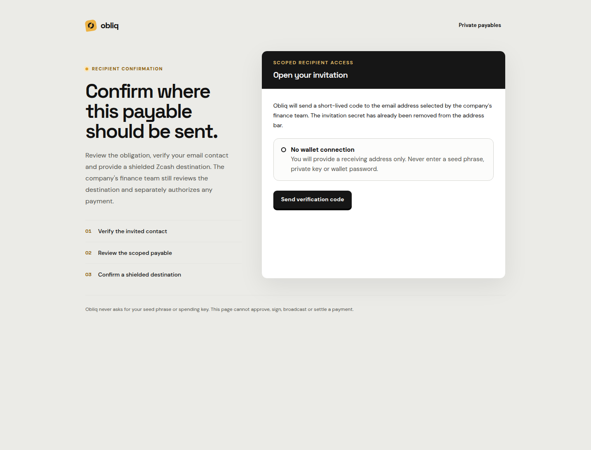
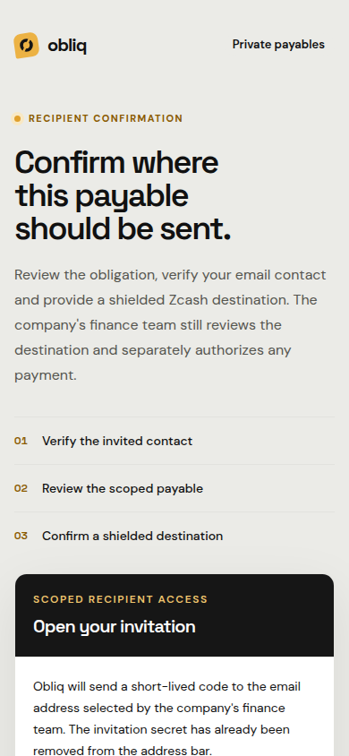

# Private Payables Link UI evidence

Status: **IMPLEMENTED / LOCAL TEST FIXTURE**

These captures demonstrate the responsive invitation-entry layout only. They
were rendered from the production Next.js build at `127.0.0.1` with a synthetic
fragment token. The browser removed the fragment before rendering the active
entry state. No email was delivered, no real invitation or destination was
used, and no payment was approved, signed, broadcast, or settled.

## Desktop

## Mobile

The mobile page continues below the viewport and is intentionally scrollable;
the capture verifies the narrow-width hierarchy and lack of horizontal
overflow. Full email-code and destination browser acceptance remains blocked
until a private test environment has a real mail adapter and isolated address
inspector. Repository and domain integration tests cover expiry, revocation,
replay, idempotent recovery, concurrent confirmation, tenant isolation,
destination invalidation, signed-state protection, and broadcast-observer
preservation.
